# sec-spring : API REST sécurisée par JWT avec Spring Security

Rapport technique et documentation du projet. Auteur : Badr Eddine TOUBANI, Master SDIA, ENSET Mohammedia. Module Sécurité des systèmes distribués.

Le projet met en place une authentification sans état (stateless) : un client s'inscrit, se connecte, reçoit un jeton JWT signé, puis l'envoie dans l'en-tête `Authorization` à chaque appel vers les routes protégées. Le serveur ne garde aucune session. Le code suit la démarche du support de cours « Implémentation avec Spring Boot » (SecurityConfig, JwtFilter, JwtService, CustomUserDetailsService, AuthController, UserController), adaptée à la structure de paquets déjà présente dans le projet.

Toutes les captures d'exécution de ce document viennent du Terminal et de Safari sur ma machine. Les captures de code sont des code snaps générés à partir des fichiers sources réels.

---

## Sommaire

1. [Pile technique](#1-pile-technique)
2. [Architecture et flux d'authentification](#2-architecture-et-flux-dauthentification)
3. [Structure du projet](#3-structure-du-projet)
4. [Démarrage rapide](#4-démarrage-rapide)
5. [Référence de l'API](#5-référence-de-lapi)
6. [Implémentation](#6-implémentation)
7. [Corrections apportées au code existant](#7-corrections-apportées-au-code-existant)
8. [Tests et résultats](#8-tests-et-résultats)
9. [Limites et pistes d'amélioration](#9-limites-et-pistes-damélioration)

---

## 1. Pile technique

| Élément | Version / choix | Rôle |
|---|---|---|
| Java | 21 | Langage, records pour les DTO |
| Spring Boot | 4.1.1 | Socle applicatif (`starter-webmvc`, `starter-data-jpa`, `starter-security`) |
| Spring Security | fourni par Boot | Chaîne de filtres, `AuthenticationManager`, BCrypt |
| JJWT | 0.13.0 (`api`, `impl`, `jackson`) | Création et vérification des jetons HS256 |
| H2 | base en mémoire `jdbc:h2:mem:security-sd` | Stockage des utilisateurs, console web `/h2-console` |
| Lombok | `@Data`, constructeurs | Entité `AppUser` |
| JUnit 5 + MockMvc | `starter-*-test` | Tests unitaires et tests d'intégration |

## 2. Architecture et flux d'authentification

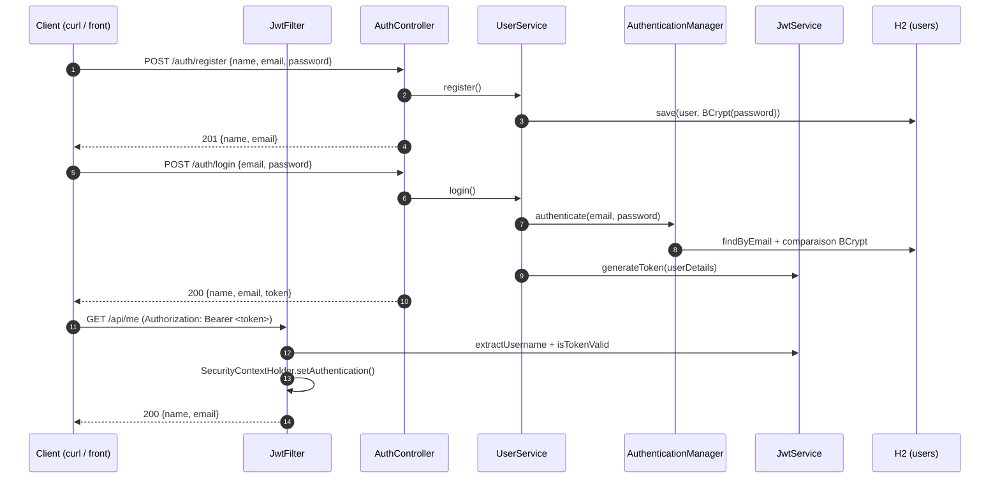

Règles d'accès définies dans `SecurityConfig` :

| Chemin | Accès |
|---|---|
| `/auth/**` | public (inscription, connexion) |
| `/h2-console/**` | public (outil de développement) |
| `/api/**` | jeton JWT valide obligatoire, sinon **401** |
| tout le reste | public |

CSRF est désactivé, ce qui se justifie ici : l'API n'utilise ni cookie de session ni formulaire, le jeton voyage dans un en-tête que le navigateur n'ajoute jamais tout seul. La politique de session est `STATELESS`.

## 3. Structure du projet

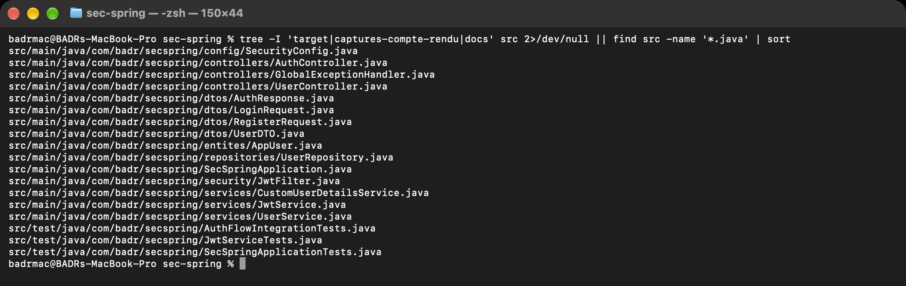

```
src/main/java/com/badr/secspring
├── SecSpringApplication.java
├── config/SecurityConfig.java            chaîne de filtres, BCrypt, AuthenticationManager
├── security/JwtFilter.java               lecture et validation du jeton à chaque requête
├── controllers/
│   ├── AuthController.java               /auth/register, /auth/login
│   ├── UserController.java               /api/hello, /api/profile, /api/me
│   └── GlobalExceptionHandler.java       erreurs métier en JSON (400, 401)
├── services/
│   ├── JwtService.java                   génération, lecture et validation du JWT
│   ├── CustomUserDetailsService.java     charge l'utilisateur par email pour Spring Security
│   └── UserService.java                  logique d'inscription et de connexion
├── entites/AppUser.java                  table users (UUID, name, email unique, password, role)
├── repositories/UserRepository.java      findByEmail, existsByEmail
└── dtos/                                 RegisterRequest, LoginRequest, AuthResponse, UserDTO
```

Le support de cours place la logique d'inscription directement dans `AuthController`. Le projet disposait déjà d'une classe `UserService` vide : la logique y a été déplacée pour garder un contrôleur mince et une couche service testable.

## 4. Démarrage rapide

Prérequis : JDK 21. Maven n'est pas nécessaire, le wrapper `mvnw` est fourni.

```bash
# compilation + exécution des 9 tests
./mvnw clean package

# lancement (port 8080 par défaut)
java -jar target/sec-spring-0.0.1-SNAPSHOT.jar
# ou sur un autre port
java -jar target/sec-spring-0.0.1-SNAPSHOT.jar --server.port=8081
```

Scénario complet en ligne de commande :

```bash
curl -X POST localhost:8081/auth/register -H 'Content-Type: application/json' \
     -d '{"name":"Badr","email":"badr@enset.ma","password":"Secret123"}'

TOKEN=$(curl -s -X POST localhost:8081/auth/login -H 'Content-Type: application/json' \
     -d '{"email":"badr@enset.ma","password":"Secret123"}' | jq -r .token)

curl -H "Authorization: Bearer $TOKEN" localhost:8081/api/me
```

Console H2 : `http://localhost:8081/h2-console`, URL JDBC `jdbc:h2:mem:security-sd`, utilisateur `sa`, mot de passe vide.

## 5. Référence de l'API

| Méthode | Route | Corps | Succès | Erreurs |
|---|---|---|---|---|
| POST | `/auth/register` | `{name, email, password}` | **201** `{name, email}` | **400** `{"error":"Email deja utilise"}` |
| POST | `/auth/login` | `{email, password}` | **200** `{name, email, token}` | **401** `{"error":"Email ou mot de passe incorrect"}` |
| GET | `/api/hello` | aucun | **200** `Bienvenue dans l'API securisee` | **401** sans jeton ou jeton invalide |
| GET | `/api/profile` | aucun | **200** `Utilisateur connecte : <email>` | **401** |
| GET | `/api/me` | aucun | **200** `{name, email}` | **401** |

Les routes `/api/**` attendent l'en-tête `Authorization: Bearer <jeton>`.

### Configuration (`application.yaml`)

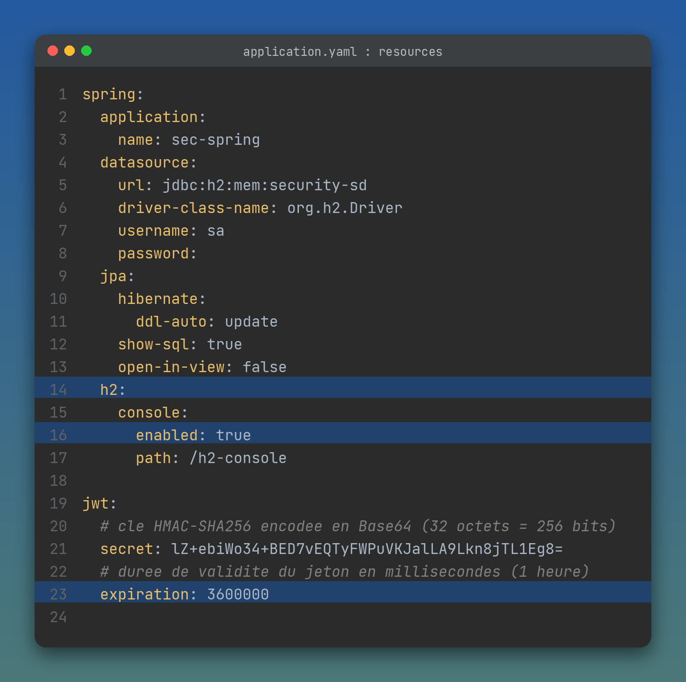

| Clé | Valeur | Remarque |
|---|---|---|
| `jwt.secret` | 44 caractères Base64 | 32 octets décodés, soit 256 bits : la taille minimale exigée par JJWT pour HS256 |
| `jwt.expiration` | `3600000` | en millisecondes, donc 1 heure |
| `spring.jpa.hibernate.ddl-auto` | `update` | la table `users` est créée au démarrage |
| `spring.h2.console.enabled` | `true` | console accessible sur `/h2-console` |

En production, le secret sortirait du fichier pour passer par une variable d'environnement (`JWT_SECRET`) ou un coffre de secrets.

## 6. Implémentation

Les lignes surlignées en bleu sont celles qui portent la logique de sécurité.

### 6.1 SecurityConfig

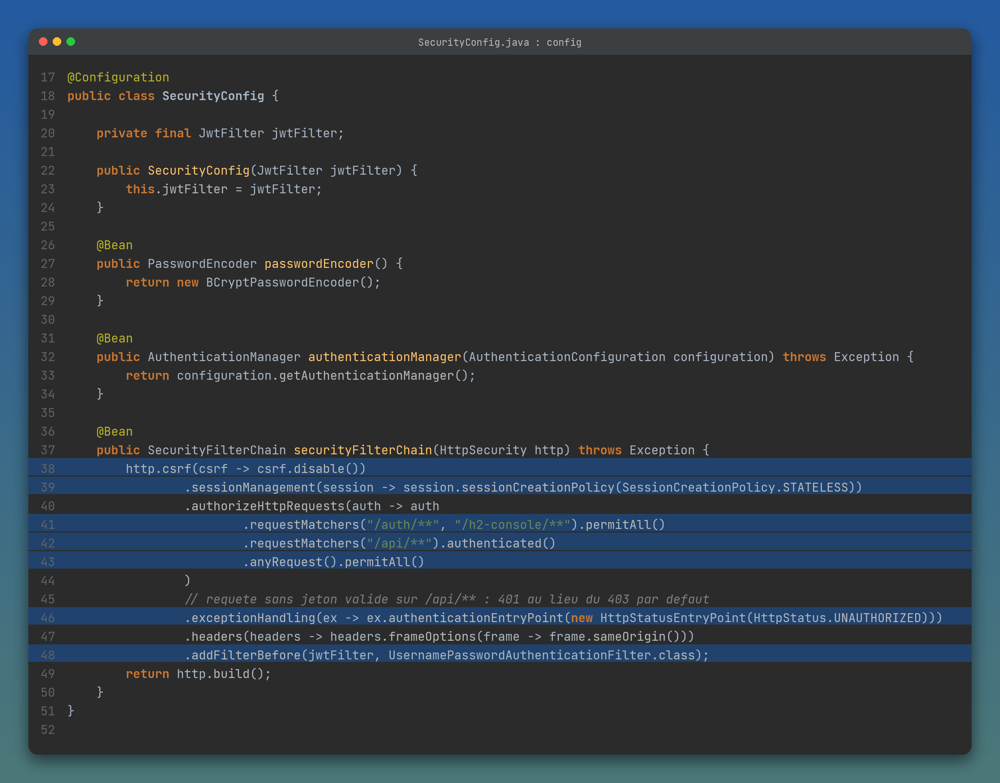

- `BCryptPasswordEncoder` hache les mots de passe avec un sel aléatoire et un coût de 10.
- `AuthenticationManager` vient de `AuthenticationConfiguration`. Spring Boot le branche sur le seul `UserDetailsService` présent (`CustomUserDetailsService`) et sur le `PasswordEncoder` déclaré.
- Ligne 46 : le support de cours ne la contient pas. Sans elle, Spring Security renvoie **403** à une requête anonyme sur `/api/**`, faute de point d'entrée (pas de formulaire ni de Basic). Avec `HttpStatusEntryPoint(UNAUTHORIZED)`, la réponse devient **401**, le code correct pour « non authentifié ».
- Ligne 47 : `frameOptions.sameOrigin()` laisse la console H2 s'afficher dans ses propres frames.
- Ligne 48 : `JwtFilter` passe avant `UsernamePasswordAuthenticationFilter`.

### 6.2 JwtFilter

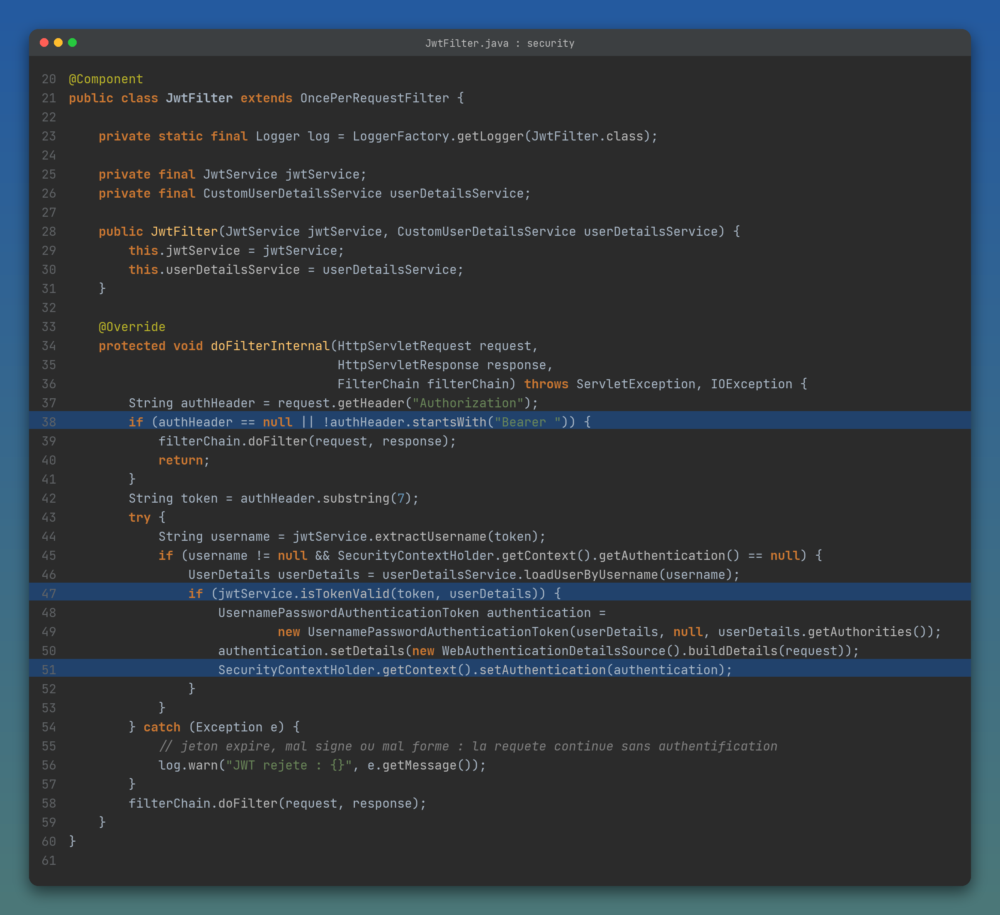

Le filtre hérite de `OncePerRequestFilter`. Sans en-tête `Bearer`, il laisse passer la requête telle quelle : la décision revient ensuite aux règles d'accès. Avec un jeton, il extrait l'email, recharge l'utilisateur, vérifie signature et expiration, puis place un `UsernamePasswordAuthenticationToken` dans le `SecurityContext`. Un jeton expiré, falsifié ou mal formé déclenche une exception JJWT : elle est journalisée en `WARN` et la requête continue sans authentification, ce qui aboutit à un 401 sur `/api/**`.

### 6.3 JwtService

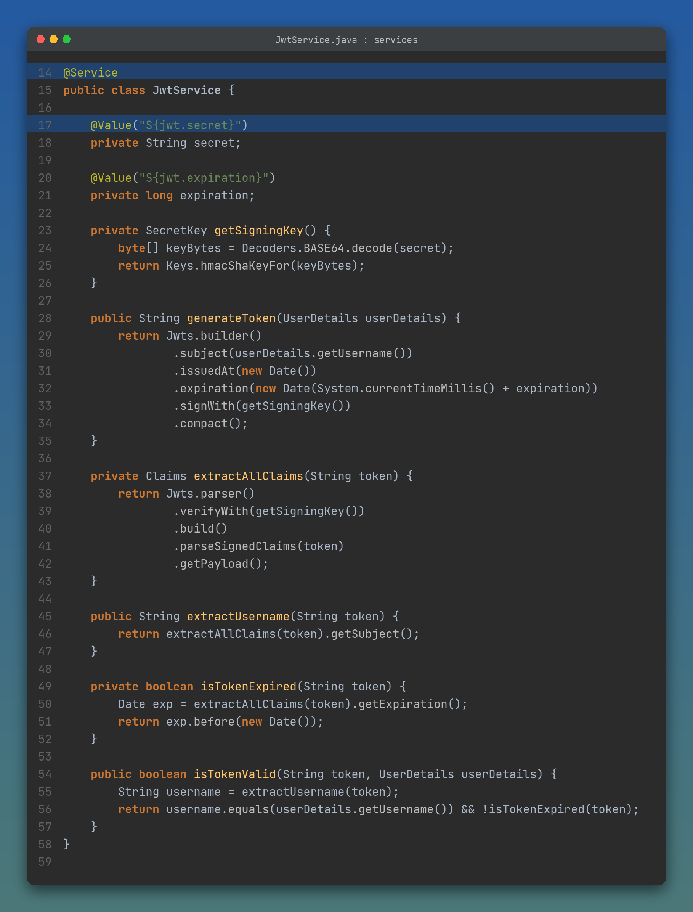

La clé HMAC est reconstruite depuis le secret Base64 avec `Keys.hmacShaKeyFor`. Le jeton contient trois claims : `sub` (email), `iat` (date d'émission) et `exp` (expiration). La vérification utilise l'API JJWT 0.13 : `verifyWith(key)` puis `parseSignedClaims(token)`, qui rejette toute signature qui ne correspond pas.

### 6.4 CustomUserDetailsService

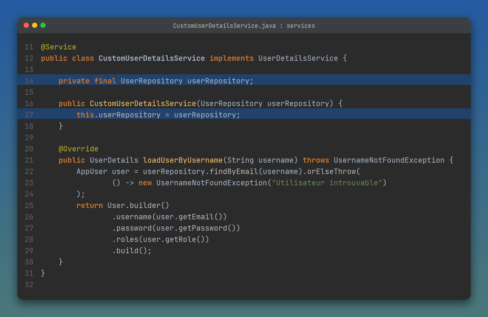

Le repository passe maintenant par le constructeur (champ `final`). L'email sert d'identifiant de connexion, le rôle est converti en autorité `ROLE_USER` par `roles()`.

### 6.5 UserService

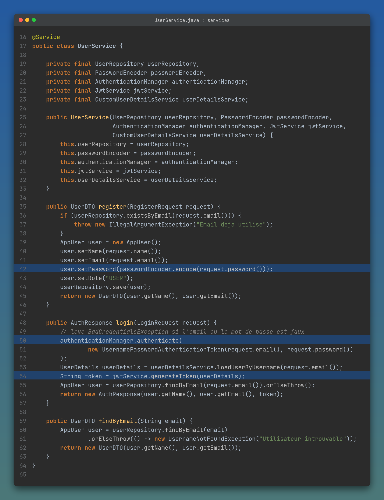

- `register` refuse un email déjà pris, hache le mot de passe (ligne 42) et enregistre l'utilisateur avec le rôle `USER`.
- `login` délègue la vérification à `AuthenticationManager` (ligne 50). Une erreur d'identifiants lève `BadCredentialsException`, le jeton n'est généré qu'après succès (ligne 54).

### 6.6 Contrôleurs et gestion des erreurs

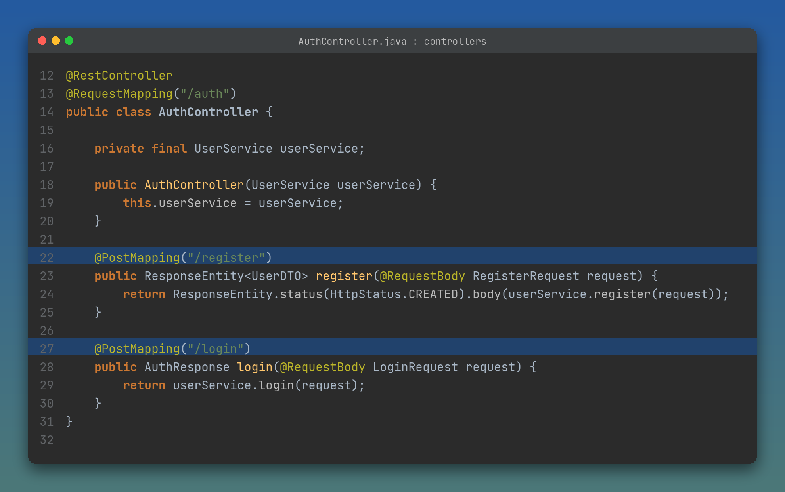

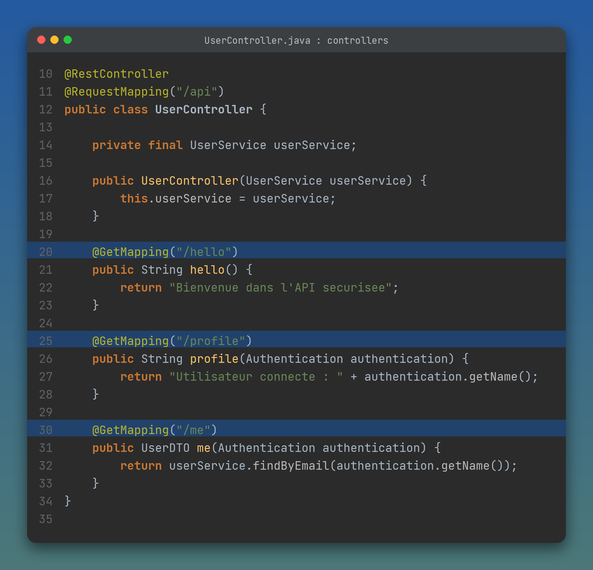

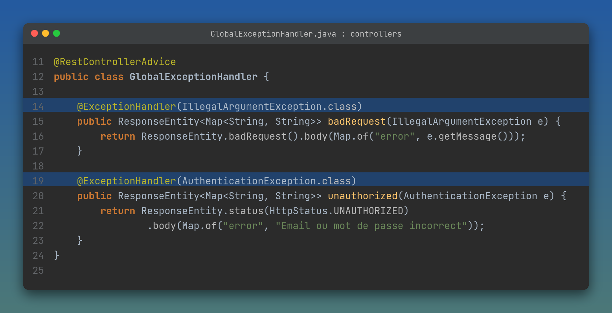

`GlobalExceptionHandler` transforme les exceptions en réponses JSON lisibles : `IllegalArgumentException` donne un 400, toute `AuthenticationException` levée dans un contrôleur donne un 401 avec un message volontairement vague, pour ne pas révéler si c'est l'email ou le mot de passe qui est faux.

## 7. Corrections apportées au code existant

Le projet de départ compilait mais ne permettait aucune authentification. Une copie de l'état initial est conservée dans `.backup-avant-completion/`.

| # | Fichier | Problème initial | Correction |
|---|---|---|---|
| 1 | `CustomUserDetailsService` | `userRepository` jamais injecté : `NullPointerException` à chaque connexion, masquée en 401 | injection par constructeur, champ `final` |
| 2 | `JwtService` | pas d'annotation `@Service`, la classe n'était pas un bean | `@Service` ajouté |
| 3 | `JwtService` | `@Value("${jwt.secre}")`, clé mal orthographiée | `${jwt.secret}` |
| 4 | projet | aucune `SecurityFilterChain` : configuration par défaut (formulaire, Basic, CSRF) | `config/SecurityConfig` |
| 5 | projet | aucun filtre JWT | `security/JwtFilter` |
| 6 | projet | aucun contrôleur | `AuthController`, `UserController` |
| 7 | projet | aucun `PasswordEncoder` | `BCryptPasswordEncoder` |
| 8 | `UserService` | classe vide | inscription, connexion, profil |
| 9 | `application.yaml` | `expiration: 360090` (environ 6 min, faute de frappe probable) | `3600000` (1 h), console H2 et JPA configurés |
| 10 | `pom.xml` | `jjwt-jackson` déclaré 3 fois, avertissements Maven | une seule déclaration |
| 11 | `AppUser` / `UserRepository` | rôle `"user"`, import `@Builder` inutilisé, `Boolean existsByEmail` | rôle `"USER"`, table `users`, `boolean` |

## 8. Tests et résultats

### 8.1 Tests automatisés (JUnit 5)

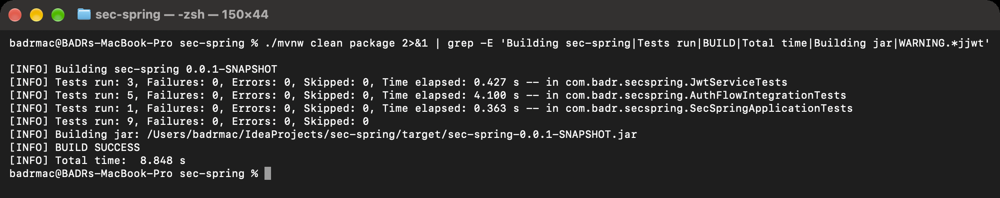

| Classe | Test | Vérifie |
|---|---|---|
| `JwtServiceTests` | `generatedTokenContainsSubjectAndIsValid` | jeton en 3 parties, `sub` correct, jeton valide |
| | `tokenOfAnotherUserIsRejected` | un jeton d'Alice ne vaut pas pour Bob |
| | `expiredTokenThrows` | un jeton expiré lève `ExpiredJwtException` |
| `AuthFlowIntegrationTests` (MockMvc) | `registerCreatesUserThenRejectsDuplicate` | 201 puis 400 sur le même email |
| | `loginWithWrongPasswordReturns401` | mauvais mot de passe : 401 |
| | `apiWithoutTokenReturns401` | `/api/hello` sans jeton : 401 |
| | `apiWithInvalidTokenReturns401` | jeton mal formé : 401 |
| | `apiWithValidTokenReturns200` | `/api/hello`, `/api/profile`, `/api/me` : 200 avec le bon contenu |
| `SecSpringApplicationTests` | `contextLoads` | le contexte Spring démarre |

Résultat : **9 tests, 0 échec, 0 erreur**, `BUILD SUCCESS` en 8,8 s.

### 8.2 Démarrage de l'application

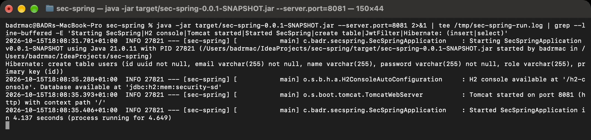

Hibernate crée la table `users`, la console H2 est exposée sur `/h2-console` et Tomcat écoute sur le port 8081 (le 8080 était occupé par un autre projet sur la machine). Démarrage en 4,1 s.

### 8.3 Inscription

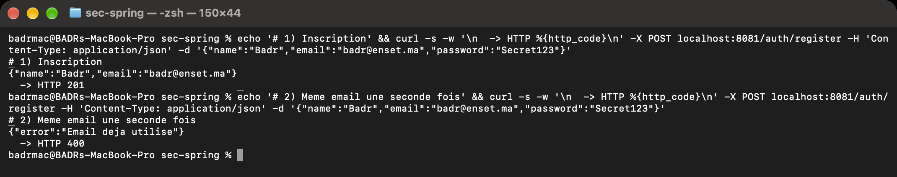

La première inscription renvoie **201** avec le nom et l'email, sans le mot de passe. La seconde, avec le même email, renvoie **400** et le message `Email deja utilise`.

### 8.4 Connexion et contenu du jeton

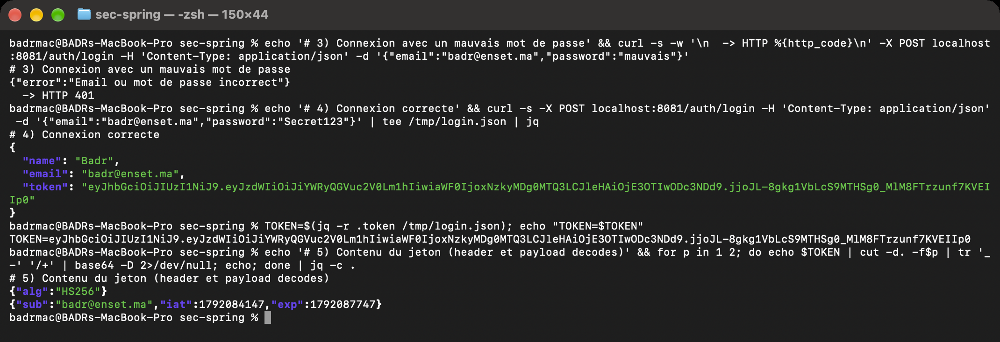

Avec un mauvais mot de passe : **401**. Avec les bons identifiants, la réponse contient le jeton. Le décodage Base64URL de ses deux premières parties montre l'en-tête `{"alg":"HS256"}` et la charge utile `{"sub":"badr@enset.ma","iat":1792084147,"exp":1792087747}`. L'écart entre `exp` et `iat` vaut 3 600 s, soit l'heure configurée. La charge utile est lisible par n'importe qui : elle n'est que signée, pas chiffrée, d'où l'absence de toute donnée sensible dedans.

### 8.5 Accès aux routes protégées

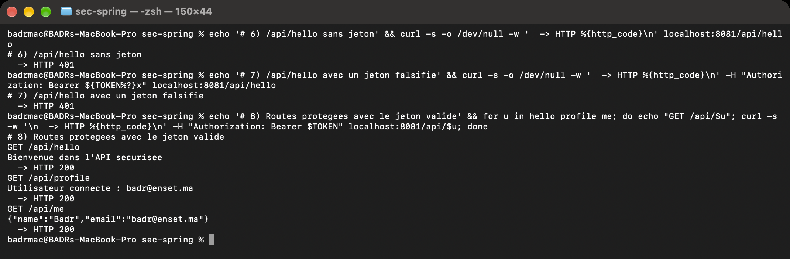

| Cas | Résultat attendu | Résultat obtenu |
|---|---|---|
| `/api/hello` sans en-tête | 401 | **401** |
| `/api/hello` avec le dernier caractère de la signature modifié | 401 | **401** |
| `/api/hello` avec le jeton valide | 200 | **200** `Bienvenue dans l'API securisee` |
| `/api/profile` avec le jeton valide | 200 | **200** `Utilisateur connecte : badr@enset.ma` |
| `/api/me` avec le jeton valide | 200 | **200** `{"name":"Badr","email":"badr@enset.ma"}` |

### 8.6 Expiration du jeton

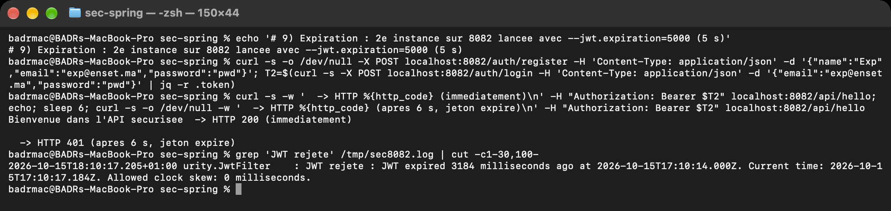

Une seconde instance a été lancée sur le port 8082 avec `--jwt.expiration=5000`. Le jeton obtenu fonctionne tout de suite (**200**), puis est refusé six secondes plus tard (**401**). Le journal du serveur indique la cause : `JWT expired 3184 milliseconds ago`.

### 8.7 Journal du serveur

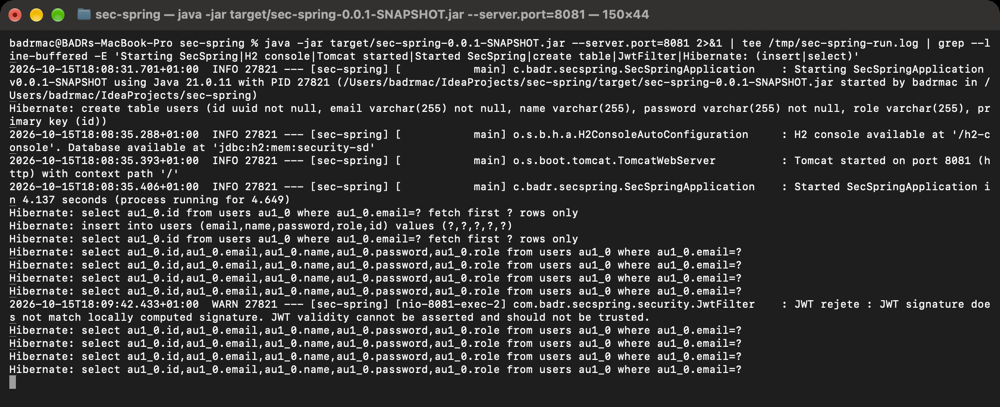

On y lit la séquence complète : `select ... where email=?` pour le contrôle d'unicité, `insert into users`, les lectures lors des connexions, et la ligne `WARN ... JwtFilter : JWT rejete : JWT signature does not match locally computed signature` au moment du test avec le jeton falsifié.

### 8.8 Base H2 : mots de passe hachés

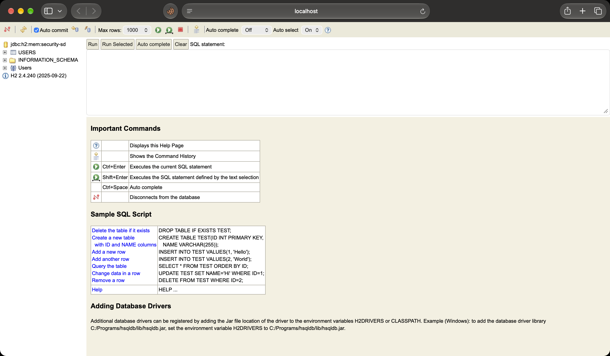

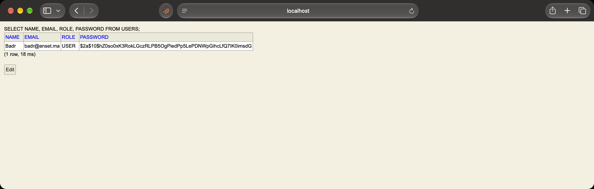

La colonne `PASSWORD` contient `$2a$10$...` : préfixe BCrypt, coût 10, sel puis empreinte. Le mot de passe en clair `Secret123` n'apparaît nulle part.

### 8.9 Bilan

| Fonction | État |
|---|---|
| Inscription avec hachage BCrypt et contrôle d'unicité | fonctionne |
| Connexion et émission d'un JWT HS256 | fonctionne |
| Protection de `/api/**` par le filtre JWT | fonctionne |
| Rejet d'un jeton absent, falsifié ou expiré (401) | fonctionne |
| Messages d'erreur JSON | fonctionne |
| Console H2 accessible | fonctionne |

## 9. Limites et pistes d'amélioration

- **Pas de refresh token** : à l'expiration, l'utilisateur doit se reconnecter. Un couple jeton court + jeton de rafraîchissement stocké côté serveur réglerait ce point et permettrait la révocation.
- **Pas de validation des entrées** : un email mal formé ou un mot de passe vide sont acceptés. Ajouter `spring-boot-starter-validation` avec `@Email`, `@NotBlank` et `@Size` sur les records.
- **Secret dans le dépôt** : le passer en variable d'environnement.
- **Console H2 publique** : à réserver au profil `dev`.
- **Rôles** : tous les comptes ont `USER`. Des routes `ADMIN` avec `@PreAuthorize("hasRole('ADMIN')")` montreraient l'autorisation fine.
- **Double enregistrement du filtre** : déclaré en `@Component`, `JwtFilter` est aussi ajouté par Spring Boot à la chaîne de filtres du conteneur. `OncePerRequestFilter` empêche une double exécution, mais un `FilterRegistrationBean` désactivé rendrait la configuration plus nette.
